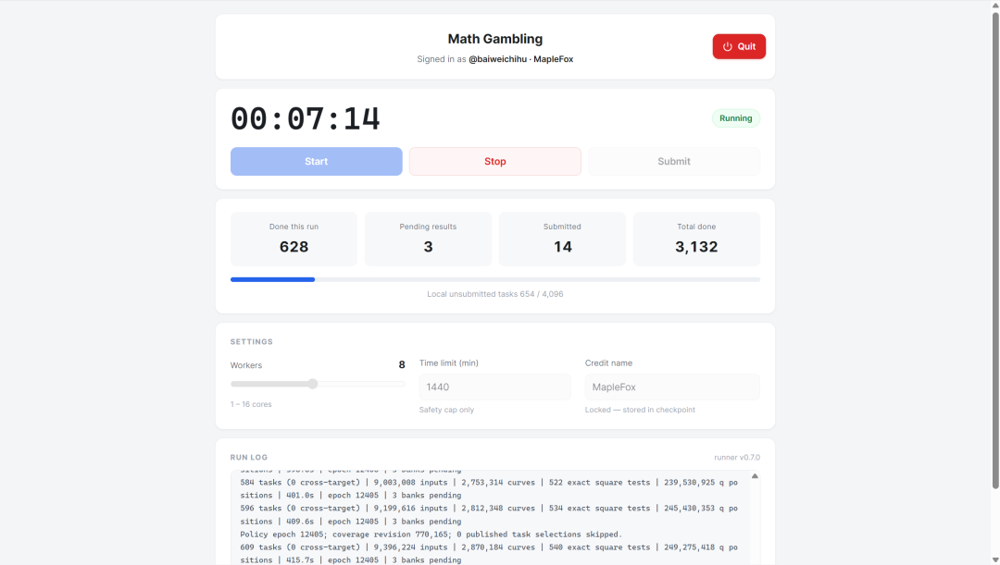

# Math Gambling Console

An unofficial local GUI for the [Math Gambling](https://kuber.studio/math-gambling/) volunteer
compute runner. Double-click, your browser opens, and you get a timer, a worker slider, a stop
button and an on-demand submit button instead of a wall of CLI flags.

Hard-wired to the **k = 114** campaign; the upstream cross-target slice is always disabled.



> Not affiliated with the upstream project. No upstream code is included — Math Gambling is a
> separate GPL-2.0 project that you download yourself.

---

## Requirements

- Windows (the server itself is portable; only `start.bat` is Windows-specific)
- Python 3.11+ on `PATH`
- [GitHub CLI](https://cli.github.com/), with `gh auth login` done once. Without it you can still
  compute, but not submit.

Worker counts and the GitHub identity are detected at runtime — nothing is machine-specific.

## Setup

1. Download the runner ZIP from the [upstream releases](https://github.com/Kuberwastaken/math-gambling/releases)
   and check it against the published `SHA256SUMS.txt`.
2. Extract it into the project root. The archive already contains a `math-gambling/` folder:
   ```powershell
   Expand-Archive .\math-gambling-runner-<version>.zip -DestinationPath .
   ```
   You should now have `math-gambling/tools/runner.py`.
3. Run `start.bat` (use `start.bat debug` to keep the console window and see live errors).

## Usage

1. The **Credit name** is pre-filled from your `gh` credentials. It is frozen into the checkpoint on
   the first run and cannot be changed afterwards.
2. Pick a worker count, press **Start**.
3. Press **Stop** whenever you like — in-flight tasks finish, everything is written to disk, and the
   next run resumes from the same checkpoint.
4. Press **Submit** to publish finished results to the upstream repository.

| Setting | Behaviour |
|---|---|
| Workers | 1 … CPU count (max 32), default is half the cores capped at 4 |
| Time limit | Safety cap, 1–1440 min. The timer counts **up** and you can stop any time; the cap only exists because the runner has no "run forever" mode |
| Credit name | Self-reported label in submitted issues; locked after the first run |

## Good to know

- **The 4096 cap.** The runner stops dispatching once 4096 finished-but-unsubmitted tasks pile up.
  This console never auto-submits, so long runs will reach it. When the state shows **Limit
  reached**, press **Submit** to clear the queue and continue.
- **Submitting is public.** Each result bundle becomes a public GitHub issue carrying your credit
  name, username and task digests. It cannot be undone.
- **Stopping is graceful.** The console broadcasts a console Ctrl+C to the runner, which then drains
  and saves. This is why it must not be started with `pythonw` — without a console there is no event
  to send.
- **On a discovery** a full-screen overlay shows the three integers, verified locally with exact
  integer arithmetic, plus a browser notification. It reads from the checkpoint, so it reappears
  after a restart. A discovery screen is not a verified result — upstream review decides that.

## How it works

`app/server.py` serves a single page on `127.0.0.1` and manages one runner child process. Live
progress is parsed from the runner's stdout; counters come from a read-only SQLite connection to
`checkpoint.sqlite3`. The page polls `/api/state` every 1.5 s, so the browser can be closed and
reopened at any time. All state lives on disk under `math-gambling/math-gambling-run/`, which is
git-ignored.

## Troubleshooting

| Symptom | Fix |
|---|---|
| Double-click does nothing | `start.bat debug`, or read `logs/console.log` |
| Stop does nothing | The console was started with `pythonw`; use `start.bat` |
| "Locked — stored in checkpoint" | The credit name is frozen; changing it means deleting the checkpoint, which also discards local unsubmitted work |
| `Coverage download unavailable: HTTPError` | Transient network failure fetching the upstream index. Results are safe; press **Start** to resume |

## License

MIT — see [LICENSE](LICENSE). The upstream
[Math Gambling](https://github.com/Kuberwastaken/math-gambling) runner is a separate GPL-2.0
project, not included or redistributed here; credit for the search and verification belongs to its
authors.
